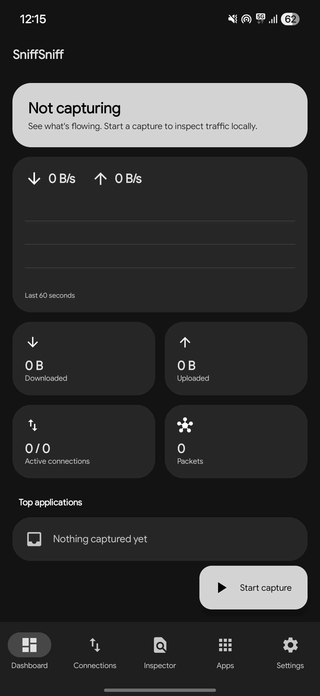
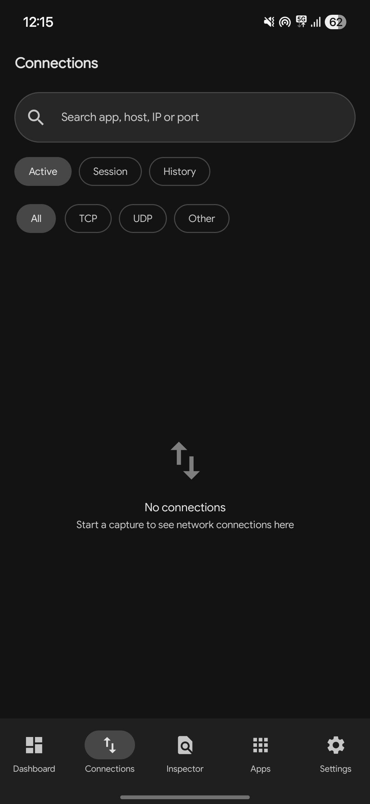
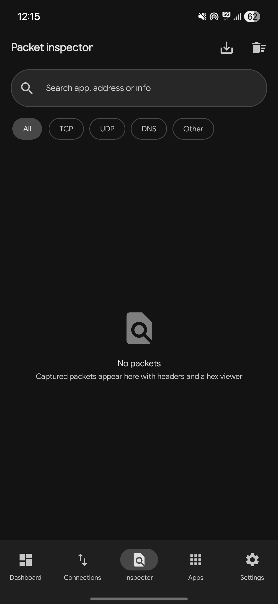
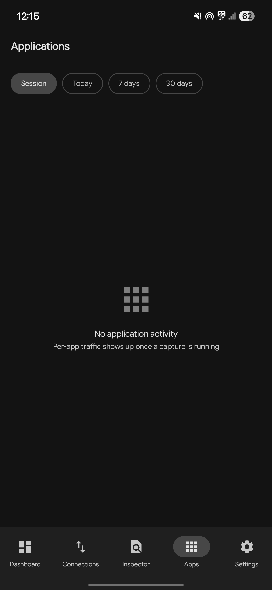

<div align="center">

<h1>SniffSniff</h1>
<p>A modern, open-source network monitor for Android. Built with Jetpack Compose and Material 3 Expressive</p>
<p>See what's flowing. Local-only packet analysis with a privacy-first design.</p>
</div>

---

## Screenshots

<div align="center">




</div>

---

## Features

### Network Analysis
- **Dashboard:** Live download and upload speed, a 60 second traffic graph, totals, packet and connection counters.
- **Connections:** IP addresses, ports, protocols and the owning app. Host names come from TLS SNI, HTTP Host and DNS answers.
- **Packet Inspector:** Parsed IPv4, IPv6, TCP, UDP, ICMP, DNS, TLS and HTTP headers, payload preview and a hex viewer.
- **Applications:** Per-app traffic for the current session, today, 7 days and 30 days.
- **PCAP Export:** Save captured packets and open them in Wireshark.

### Beautiful Design
- **Material 3 Expressive:** Grouped rounded surfaces, spring transitions and expressive loading indicators.
- **Dynamic Color (Material You):** Themes that adapt to your wallpaper, plus a monochrome fallback.
- **Dark Mode & OLED Support:** Light, dark and a "Pure Black" mode.

### Privacy & FOSS
- **GPL-3.0-or-later.**
- **No analytics, telemetry, ads or accounts.**
- **No cloud and no external APIs.** All analysis happens on your device.
- **User-controlled capture:** Choose which apps are captured, how much payload is kept, and how long history is stored.

---

## Tech Stack

| Component         | Technology                  |
| ----------------- | --------------------------- |
| Language          | Kotlin                      |
| UI                | Jetpack Compose             |
| Design            | Material 3 Expressive       |
| Architecture      | MVVM                        |
| Async             | Coroutines + Flow           |
| DI                | Hilt                        |
| Database          | Room                        |
| Preferences       | DataStore                   |
| Network capture   | Android VpnService          |
| Packet processing | Kotlin (user-space TCP/UDP) |
| Minimum SDK       | 31 (Android 12)             |

## Project Structure

```text
SniffSniff/
├── app/
├── core/
│   ├── common/
│   ├── database/
│   └── designsystem/
├── feature/
│   ├── dashboard/
│   ├── connections/
│   ├── inspector/
│   ├── applications/
│   └── settings/
└── network/
    ├── vpn/
    ├── capture/
    ├── forwarding/
    ├── parser/
    ├── flow/
    └── pcap/
```

Traffic path: `VpnService TUN` → `forwarding` (protected sockets) → `capture` (parser, flow table, UID lookup) → `ViewModel + Repository` → Compose UI.

---

## Building

1. Install Android Studio with JDK 21.
2. Copy `local.properties.template` to `local.properties` and set `sdk.dir`.
3. Run `./gradlew assembleDebug`.

## Limitations

- TLS and QUIC payloads are encrypted. SniffSniff shows metadata only and does not decrypt traffic.
- ICMP is captured and shown but not forwarded.
- Android's Private DNS (DNS over TLS) hides DNS names. Disable it for host names from DNS.
- Another active VPN or an always-on VPN lockdown prevents capture.

## License

Distributed under the GNU General Public License v3.0 or later (GPL-3.0-or-later). See [LICENSE](LICENSE) for more information.

---

## Contributing

Contributions are welcome! Feel free to open [issues](https://github.com/rynekryz/sniffsniff/issues) or submit pull requests.

<div align="center">
<strong>Made with ♥︎ by Ryne</strong>
</div>
<div align="center">
  <a href="DISCORD_INVITE"></a>
  <a href="https://tiktok.com/@rynekryz"></a>
</div>
