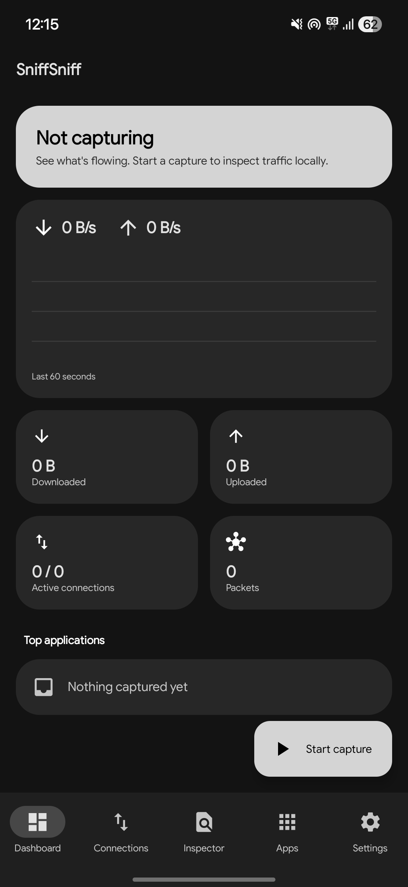
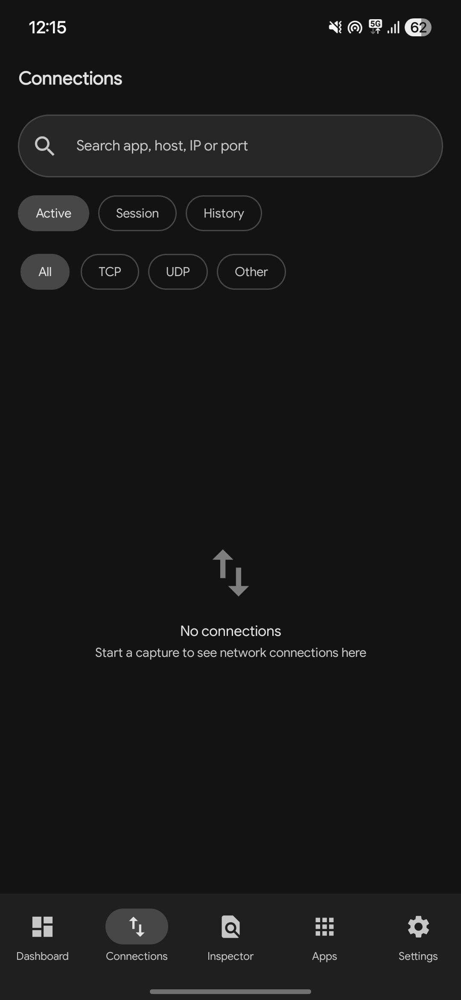
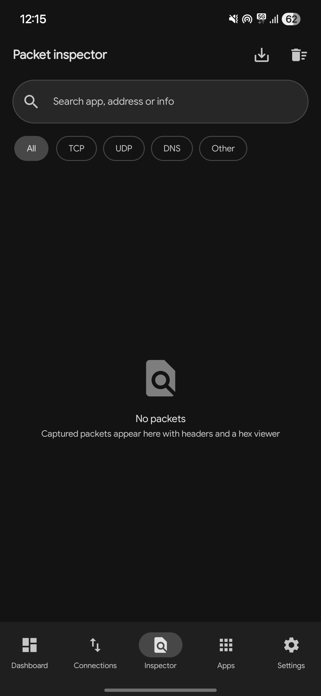
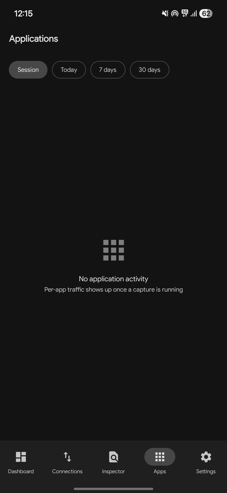

<div align="center">

<!-- decor:top -->
<picture><source media="(prefers-color-scheme: dark)" srcset="https://raw.githubusercontent.com/rynekryz/rynekryz/main/pixel-art/sky-banner-dark.svg"></picture>

<picture><source media="(prefers-color-scheme: dark)" srcset="https://raw.githubusercontent.com/rynekryz/rynekryz/main/pixel-art/divider-dots-dark.svg"></picture>
<!-- /decor:top -->


<h1>SniffSniff</h1>
<p>An open-source network monitor for Android.</p>
<p>Watch live traffic, inspect packets, and see per-app usage, all locally with no cloud or external APIs.</p>
</div>
<p align="center">
  <a href="https://github.com/rynekryz/sniffsniff/stargazers"></a>
  <a href="https://github.com/rynekryz/sniffsniff/tags"></a>
  <a href="LICENSE"></a>
  
  
</p>

<p align="center">
  <a href="https://github.com/rynekryz/sniffsniff/releases"></a>
</p>

<div align="center">
<picture><source media="(prefers-color-scheme: dark)" srcset="https://raw.githubusercontent.com/rynekryz/rynekryz/main/pixel-art/divider-dots-dark.svg"></picture>
</div>

## Screenshots

<div align="center">




</div>

<div align="center">
<picture><source media="(prefers-color-scheme: dark)" srcset="https://raw.githubusercontent.com/rynekryz/rynekryz/main/pixel-art/divider-dots-dark.svg"></picture>
</div>

## Features

- **Dashboard:** live up/down speed, a 60 second traffic graph, totals, and packet and connection counters
- **Connections:** IPs, ports, protocols and the owning app, with host names from TLS SNI, HTTP Host and DNS
- **Packet Inspector:** parsed IPv4, IPv6, TCP, UDP, ICMP, DNS, TLS and HTTP, plus a payload preview and hex viewer
- **Applications:** per-app traffic for the session, today, 7 days and 30 days
- **PCAP export** you can open in Wireshark
- **Material 3 Expressive** with spring transitions and expressive loading
- Dynamic color from your wallpaper, plus a monochrome fallback
- Light, dark, and pure black OLED
- GPL-3.0-or-later, with no analytics, telemetry, ads or accounts
- No cloud, no external APIs, everything happens on your device
- You choose which apps are captured, how much payload is kept, and how long history is stored
- etc.

<div align="center">
<picture><source media="(prefers-color-scheme: dark)" srcset="https://raw.githubusercontent.com/rynekryz/rynekryz/main/pixel-art/divider-dots-dark.svg"></picture>
</div>

## Technical Stack

- **UI:** Jetpack Compose with Material 3 Expressive
- **Architecture:** multi-module MVVM
- **DI:** Hilt
- **Database:** Room
- **Preferences:** DataStore
- **Capture:** Android VpnService with user-space TCP/UDP
- **Language:** Kotlin
- **Build:** Gradle (Kotlin DSL)

<div align="center">
<picture><source media="(prefers-color-scheme: dark)" srcset="https://raw.githubusercontent.com/rynekryz/rynekryz/main/pixel-art/divider-dots-dark.svg"></picture>
</div>

## Building

You'll need Android Studio with JDK 21. Copy `local.properties.template` to `local.properties`, set `sdk.dir`, then run:

```bash
./gradlew assembleDebug
```

## Limitations

- TLS and QUIC payloads are encrypted. SniffSniff shows metadata only and never decrypts anything.
- ICMP is captured and shown, but not forwarded. It's just visiting.
- Android's Private DNS hides DNS names, so turn it off if you want host names.
- Another active VPN or an always-on VPN lockdown will block capture.

<div align="center">
<picture><source media="(prefers-color-scheme: dark)" srcset="https://raw.githubusercontent.com/rynekryz/rynekryz/main/pixel-art/divider-dots-dark.svg"></picture>
</div>

## Project Structure

```
SniffSniff/
├── app/
├── core/
│   ├── common/
│   ├── database/
│   └── designsystem/
├── feature/
│   ├── dashboard/
│   ├── connections/
│   ├── inspector/
│   ├── applications/
│   └── settings/
└── network/
    ├── vpn/
    ├── capture/
    ├── forwarding/
    ├── parser/
    ├── flow/
    └── pcap/
```

<div align="center">
<picture><source media="(prefers-color-scheme: dark)" srcset="https://raw.githubusercontent.com/rynekryz/rynekryz/main/pixel-art/divider-dots-dark.svg"></picture>
</div>

## License

Licensed under GPL-3.0-or-later. See [LICENSE](LICENSE).

<!-- decor:bottom -->
<div align="center">

<picture><source media="(prefers-color-scheme: dark)" srcset="https://raw.githubusercontent.com/rynekryz/rynekryz/main/pixel-art/divider-wave-dark.svg"></picture>

<picture><source media="(prefers-color-scheme: dark)" srcset="https://raw.githubusercontent.com/rynekryz/rynekryz/main/pixel-art/sticker-heart-dark.svg"></picture> <picture><source media="(prefers-color-scheme: dark)" srcset="https://raw.githubusercontent.com/rynekryz/rynekryz/main/pixel-art/sticker-sparkle-dark.svg"></picture> <picture><source media="(prefers-color-scheme: dark)" srcset="https://raw.githubusercontent.com/rynekryz/rynekryz/main/pixel-art/sticker-moon-dark.svg"></picture> <picture><source media="(prefers-color-scheme: dark)" srcset="https://raw.githubusercontent.com/rynekryz/rynekryz/main/pixel-art/sticker-flower-dark.svg"></picture> <picture><source media="(prefers-color-scheme: dark)" srcset="https://raw.githubusercontent.com/rynekryz/rynekryz/main/pixel-art/sticker-cat-dark.svg"></picture> <picture><source media="(prefers-color-scheme: dark)" srcset="https://raw.githubusercontent.com/rynekryz/rynekryz/main/pixel-art/sticker-ghost-dark.svg"></picture> <picture><source media="(prefers-color-scheme: dark)" srcset="https://raw.githubusercontent.com/rynekryz/rynekryz/main/pixel-art/sticker-lock-dark.svg"></picture>

</div>
<!-- /decor:bottom -->

<div align="center">
<strong>Made with ♥︎ by Ryne</strong>
</div>
<div align="center">
  <a href="https://discord.gg/YKhWXXhKmC"></a>
  <a href="https://tiktok.com/@rynekryz"></a>
</div>
